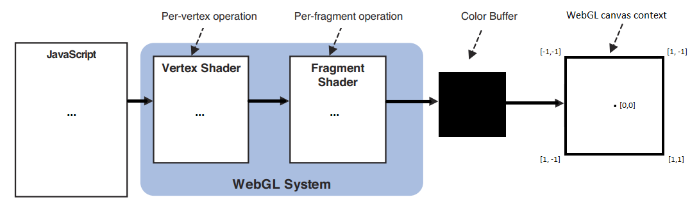

# Class 8

## 🛠️ Graphics Effects & Algorithms

- [Nature of Code](https://natureofcode.com/) by Daniel Shiffman
- [p5js libraries](https://p5js.org/libraries/)
- [List of visual algorithms](https://thatcreativecode.page/)
- [List of graphics algorithms](https://github.com/cacheflowe/creative-coding-notes#graphics-concepts) @ Cacheflowe's Creative Coding Notes
- [Post Processing As A Creative Medium](https://blog.maximeheckel.com/posts/post-processing-as-a-creative-medium/)
  - [Postprocessing demo in PIXI.js](https://pixijs.io/filters/examples/)
  - [Postprocessing demo in p5js](https://editor.p5js.org/cacheflowe/sketches/nnrNlvnFF)
  - https://alexharri.com/blog/ascii-rendering

## 🧊 3D Graphics

The Graphics pipeline

* [How do Video Game Graphics Work?](https://www.youtube.com/watch?v=C8YtdC8mxTU)
* [Projection (3D)](https://jsantell.com/3d-projection)
* [WebGL Guide](https://xem.github.io/articles/webgl-guide.html)
* [Learn OpenGL](https://learnopengl.com/)

Basic layout & 3d thinking

* We're using an abstracted tool... It's just a 3rd coordinate ;)
* Live demos
  * [for() loops 3D](https://editor.p5js.org/cacheflowe/sketches/1S7L5IqjO)
  * [3d shapes basic](https://editor.p5js.org/cacheflowe/sketches/6jSCgZm0L)
  * [3d textured sphere w/light](https://editor.p5js.org/cacheflowe/sketches/LJJZUnd9_)
  * [Graphics & textured cube](https://editor.p5js.org/cacheflowe/sketches/T2VXcVI2A)
  * [Disable depth test](https://editor.p5js.org/cacheflowe/sketches/SW763JUky)

## 🖥️ CPU vs GPU

* What tasks are handled on each?
  * Shader code and pixel display operations are handled on the GPU
  * Most of the code that you write is on the CPU, unless you're writing shaders or OpenGL code
    * Under the hood of p5js & Processing, there's a ton of OpenGL/WebGL code, so know how this stuff works is helpful to know what your performance bottlenecks might be
* What's optimized on the GPU
  * It depends on the platform and tools
    * For example, certain parts of web browser rendering happen on the GPU, but differs per browser
  * Textures & texture operations
    * Loading an image file is almost always faster than drawing vector data
  * Cached Geometry with [p5.Geometry](https://p5js.org/reference/p5/p5.Geometry/) and [buildGeometry()](https://p5js.org/reference/p5/buildGeometry/)
  * 
* [cpu.land](https://cpu.land/)
* [CPU vs GPU vs TPU vs DPU vs QPU](https://www.youtube.com/watch?v=r5NQecwZs1A)

## 📝 Homework

Read:

* The WebGL & OpenGL articles above

Watch:

* [Best Of Demoscene 2020 (Playlist)](https://www.youtube.com/watch?v=zWqfX9J9BXI&list=PL9HVvEQXdWVb22aDO98yTbhqE8zy9XaDE)
* [SIGGRAPH 2020: Technical Papers Preview Trailer](https://www.youtube.com/watch?v=jYdMKdRUq_8)
* [SIGGRAPH 2019: Technical Papers Preview Trailer](https://www.youtube.com/watch?v=EhDr3Rs5fTU)
* [SIGGRAPH 2018 Asia: Technical Papers Preview Trailer](https://www.youtube.com/watch?v=wdKpXvF_3AU)

**Build something with a 3rd dimension**

* Steps
  * Start with `WEBGL` mode in p5js
    * This moves the coordinate system to the center of the screen
  * Use `box()`, `sphere()` and other 3d primitive functions to create shapes
    * p5js has additional 3d shapes like `torus()`
* Stretch goals
  * Create your own 3d geometry with `beginShape()`, `vertex()`, and `endShape()`
  * Apply a texture to your geometry
  * Load a 3d model with [loadModel()](https://p5js.org/reference/p5/loadModel/)`
  * Use a shader to create a custom material for your 3d geometry

## 📋 Review code

* Present your audio sketches
