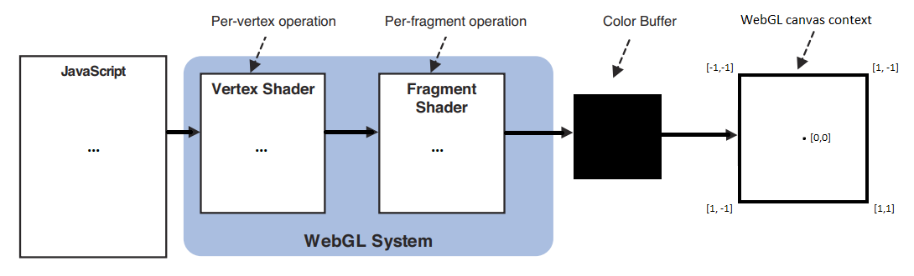

# Class 9

## 🖥️ CPU vs GPU

* What tasks are handled on each?
  * Shader code and pixel display operations are handled on the GPU
  * Most of the code that you write is on the CPU, unless you're writing shaders or OpenGL code
    * Under the hood of p5js & Processing, there's a ton of OpenGL/WebGL code, so know how this stuff works is helpful to know what your performance bottlenecks might be
* What's optimized on the GPU
  * It depends on the platform and tools
    * For example, certain parts of web browser rendering happen on the GPU, but differs per browser
  * Textures & texture operations
    * Loading an image file is almost always faster than drawing vector data
  * Cached (retained) Geometry with [p5.Geometry](https://p5js.org/reference/p5/p5.Geometry/) and [buildGeometry()](https://p5js.org/reference/p5/buildGeometry/) vs immediate mode geometry (creating geometry on the fly each frame)
  * 
* [cpu.land](https://cpu.land/)
* [CPU vs GPU vs TPU vs DPU vs QPU](https://www.youtube.com/watch?v=r5NQecwZs1A)

## 🛠️ Shaders

🎤 **Case study**: H&M + Jordan projects - shaders in a real client pipeline

* [Justin's GLSL overview article](https://github.com/cacheflowe/haxademic/blob/master/guides/shaders-intro.md)
* [Justin's PShader tutorial & examples](https://github.com/cacheflowe/pshader-examples)
* [NVIDIA: Adam and Jamie Paint the Mona Lisa in 80 Milliseconds](https://www.youtube.com/watch?v=WmW6SD-EHVY)
* [Shaders visual explanation](https://typefully.com/DanHollick/shaders-gpnhhud) by [@DanHollick](https://twitter.com/DanHollick/status/1603370500306018304)
https://www.mayerowitz.io/blog/a-journey-into-shaders

### What can they do?

* Fragment shaders
  * [Dynamic texturing & lighting](https://threejs.org/examples/#webgl_materials_bumpmap) of polygons
  * [Postprocessing effects](https://filters.pixijs.download/main/demo/index.html)
  * [Compositing](https://filters.pixijs.download/main/demo/index.html)
  * [Generative textures](https://www.shadertoy.com/view/XtyXzw)
    * [Raymarching](https://www.shadertoy.com/view/Xds3zN)!
* Vertex shaders
  * Create & [manipulate geometry](https://www.instagram.com/p/CfHwxRGlpod/)

## How to start

Interactive tutorials

* [Book of Shaders](http://thebookofshaders.com/) (+ [Editor](http://editor.thebookofshaders.com/))
* [Fragment Foundry](http://hughsk.io/fragment-foundry/)

Online editors

* [Shadertoy](http://shadertoy.com)
* [Shader Park](https://shaderpark.com/)
* [ComputeToys](https://compute.toys/)

Graham's shader blog posts

* [Introduction to Shaders in P5](https://graha.ms/posts/blog/2022-11-01-introduction-to-shaders-in-p5/)
* [Using p5 shaders for post processing](https://graha.ms/posts/blog/2022-11-10-using-p5-shaders-for-post-processing/)

p5js

* Documentation
  * [p5js shader reference](https://p5js.org/reference/p5/shader/)
  * [p5js Introduction to Shaders](https://p5js.org/tutorials/intro-to-shaders/)
  * [p5js createFilterShader()](https://p5js.org/reference/p5/createFilterShader/) (New as of p5js 1.8)
  * [p5.strands: Writing shaders in JavaScript](https://www.davepagurek.com/blog/writing-shaders-in-js/) (New as of p5js 2.0)
* [p5js examples](https://github.com/aferriss/p5jsShaderExamples)
* Justin's p5js examples
  * [Basic generative starter](https://editor.p5js.org/cacheflowe/sketches/ha6wfUQHS)
  * [Basic generative shader](https://editor.p5js.org/cacheflowe/sketches/ml0ubsQhB)
  * [Basic post-processing shader effect](https://editor.p5js.org/cacheflowe/sketches/K8LFvt_D2)
  * [Feedback effect without a shader](https://editor.p5js.org/cacheflowe/sketches/RMfzMUdhc)
  * [Feedback effect with a shader](https://editor.p5js.org/cacheflowe/sketches/TKFuqnxVE)
  * [Fancier feedback effect](https://editor.p5js.org/cacheflowe/sketches/8aCDXu1cU)
  * [Earth in space](https://editor.p5js.org/cacheflowe/sketches/fx_4KVPV1)
  * [GPGPU particles](https://editor.p5js.org/cacheflowe/sketches/qOrYNxUU2)
* [Lygia](https://lygia.xyz/)
  * https://editor.p5js.org/patriciogonzalezvivo/sketches/hwBn0i0qw
  * [w/p5js](https://editor.p5js.org/patriciogonzalezvivo/sketches)

## Further topics

[Matrices](https://vitaminac.github.io/Matrices-in-Computer-Graphics/)

- [Convolution](https://www.taylorpetrick.com/blog/post/convolution-part1)
- [Interactive image kernels](https://setosa.io/ev/image-kernels/)
- [What is a convolution? What is a "Gaussian Kernel"?](https://twitter.com/3blue1brown/status/1303489896519139328) - [Full lesson](https://youtu.be/KuXjwB4LzSA?si=SkcbUjixgL-OfDAx&t=619)

More reading

* [A Beginner's Guide to Coding Graphics Shaders](https://gamedevelopment.tutsplus.com/tutorials/a-beginners-guide-to-coding-graphics-shaders--cms-23313)
* [A Journey Into Shaders](https://www.mayerowitz.io/blog/a-journey-into-shaders)
* [An introduction to Shader Art Coding](https://www.youtube.com/watch?v=f4s1h2YETNY)
* [Shader Tutorials By XorDev](https://mini.gmshaders.com/)
* [3D Game Shaders For Beginners](https://github.com/lettier/3d-game-shaders-for-beginners)

## 📝 Homework

Read:

* [What is a particle system?](http://natureofcode.com/book/chapter-4-particle-systems/)
* [Signed Distance Field Resources](https://github.com/CedricGuillemet/SDF)
* [A trip through the Graphics Pipeline](https://fgiesen.wordpress.com/2011/07/09/a-trip-through-the-graphics-pipeline-2011-index/)
* [Casual Introduction to Low-Level Graphics Programming](http://stephaniehurlburt.com/blog/2016/10/28/casual-introduction-to-low-level-graphics-programming)
* [Computational complexity of GPGPU](https://thume.ca/2023/01/02/one-machine-twitter/)

Watch:

* [Shader Coding Introduction](https://www.youtube.com/watch?v=3mfvZ-mdtZQ&list=PLGmrMu-IwbguU_nY2egTFmlg691DN7uE5&index=1)
* [An introduction to Shader Art Coding](https://www.youtube.com/watch?v=f4s1h2YETNY)
* [Shaders and Textures with p5.js and WebGL](https://www.youtube.com/playlist?list=PLRqwX-V7Uu6bPhi8sS1hHJ77n3zRO9FR_)
* [Edan Kwan - Building Engaging WebGL Experiences](https://www.youtube.com/watch?v=lg8vukwgpo8)

**Choose your own adventure:**

- Build something with a shader
- Use a webcam
- Try a machine-learning tool
- Expand on a past week's project
- Try a new technology
- Start planning your final project (bring something to show next week)

## 📋 Review code

* Present your 3d sketches
