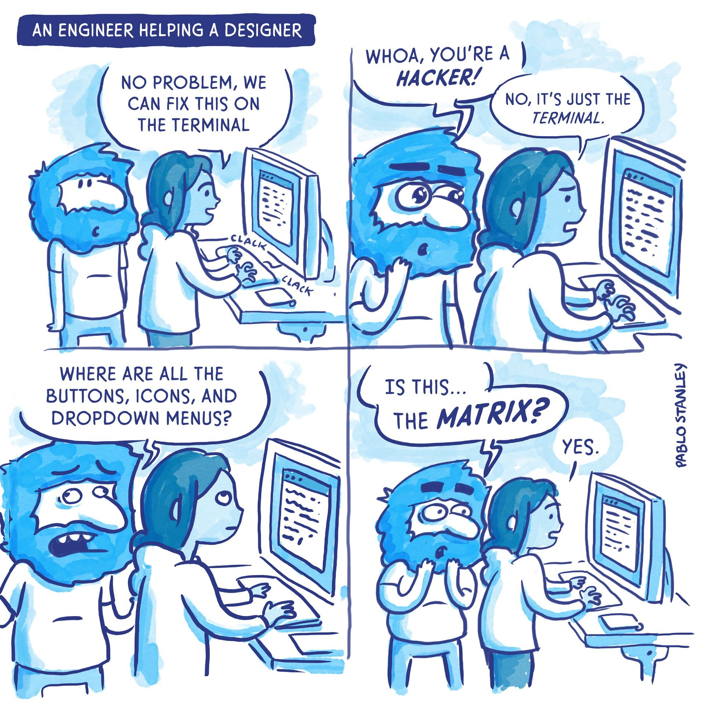
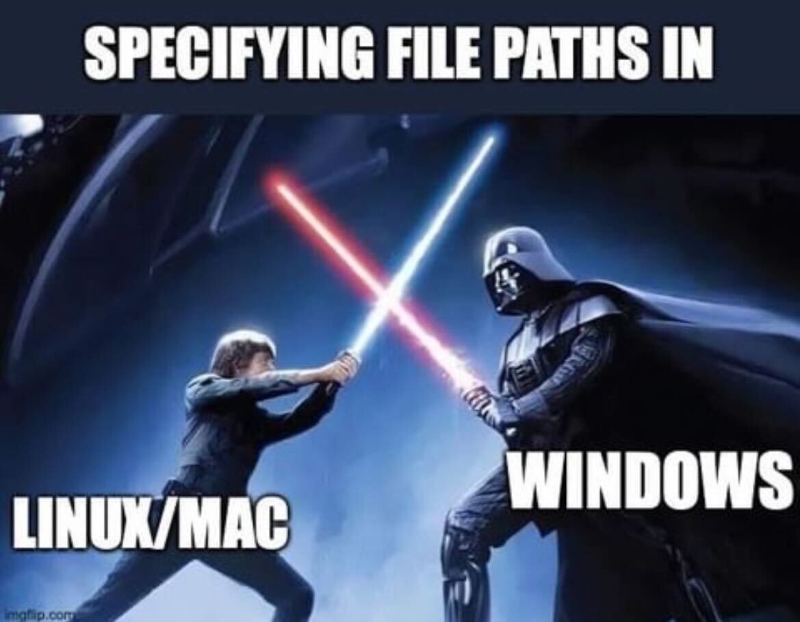
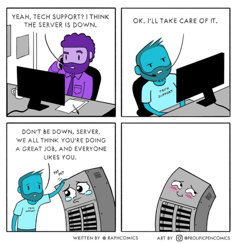

# Class 10

## 😱 Final projects

Goals:

* Combine your interests (code and not-code)
* Build something meaningful for yourself
* Experiment with a specific technology that interests you
* Flex your skills
* Learn some new techniques & revisit topics we've discussed in class

Deliverables:

* The code itself, uploaded to Canvas or hosted on your own website
* One or more of the following: 
  * A live version of your code running on a website
  * A .zip file with the code that can be run locally
  * A video recap of the code in action
  * A site-specific installation
  * A live performance
* Documentation:
  * Screenshots and/or video screen recordings that show off the output and program features
  * A description of the piece (and title if applicable). At least 1 paragraph about what you've created, what you learned, tools, techniques, and anything else that makes your project interesting. Tell a story.
  * Documentation should ideally go into your portfolio or exist on the web somewhere. You host it on your own website, the p5js editor, YouTube, or otherwise.

## 🛠️ Web Browsers

🎤 **Case study**: Wafflevision

Creative Web Dev Studios

* [Active Theory](https://activetheory.net/)
* [Lusion](https://lusion.co/)
* [Resn](https://resn.co.nz/)
* [Junni](https://next.junni.co.jp/)
* [MakeMePulse](https://www.makemepulse.com/)

Web Awards for inspiration

- https://www.awwwards.com/websites/web-interactive/
- https://www.thefwa.com
- https://winners.webbyawards.com/winners/websites-and-mobile-sites

Revisit the browser console

* Activity: alter the functionality of an existing site

SVG

* [two.js](https://two.js.org/) svg renderer
* [anime.js](https://animejs.com/) svg renderer & animation library
* [SVGomg](https://jakearchibald.github.io/svgomg/) svg optimizer

CSS

* [Enhancing User Experience With CSS Animations](https://stephaniewalter.design/blog/enhancing-user-experience-with-css-animations/)
* [CSS Doodle](https://css-doodle.com/) by [@yuanchuan](https://yuanchuan.dev/) - a tool for creating generative art with CSS
* Artist highlight: [Ana Tudor](https://codepen.io/thebabydino)
* Drawing with [A Single Div](https://a.singlediv.com/) highlights a unique approach to drawing in the browser

Interesting Web [APIs](https://developer.mozilla.org/en-US/docs/Web/API) (check [caniuse.com](https://caniuse.com/))

* [Canvas API](https://flaviocopes.com/canvas/) ([Bitmap drawing docs](https://developer.mozilla.org/en-US/docs/Web/API/Canvas_API))
* [WebGL](https://webglfundamentals.org/) (High-performance 3d graphics)
* [DeviceOrientationEvent](https://web.dev/articles/device-orientation) (Accelerometer/gyroscope)
* [MediaDevices](https://developer.mozilla.org/en-US/docs/Web/API/MediaDevices) & [Media Streams API](https://developer.mozilla.org/en-US/docs/Web/API/Media_Streams_API) (Webcam, microphone, WebRTC streaming)
* [WebSockets API](https://developer.mozilla.org/en-US/docs/Web/API/WebSockets_API) (Persistent data streams)
* [Web Audio API](https://developer.mozilla.org/en-US/docs/Web/API/Web_Audio_API) (Audio playback/analysis/synthesis)
* [WebRTC](https://webrtc.org/) (Video/audio/data streaming)
* [WebXR](https://immersiveweb.dev/) (Build VR/AR/MR in-browser, works in Quest & Apple Vision Pro)
* [Web MIDI API](https://www.smashingmagazine.com/2018/03/web-midi-api/) (MIDI devices)
* [Gamepad API](https://developer.mozilla.org/en-US/docs/Web/API/Gamepad_API) (Game controller devices)
* [Web Serial API](https://codelabs.developers.google.com/codelabs/web-serial/) (Serial devices like Arduino/Teensy)
* [WebCodecs API](https://cacheflowe.github.io/media-converter/) (Low-level media encoding/decoding)
* [Web Speech API](https://developer.mozilla.org/en-US/docs/Web/API/Web_Speech_API) (Speech recognition and synthesis)
  * [Speech recognition color changer demo](https://mdn.github.io/dom-examples/web-speech-api/speech-color-changer/) (Chrome only)
  * [Speech synthesis demo](https://mdn.github.io/dom-examples/web-speech-api/speak-easy-synthesis/)
* [Geolocation API](https://developers.google.com/web/fundamentals/native-hardware/user-location) (GPS)
* [Web Bluetooth](https://webbluetoothcg.github.io/web-bluetooth/) (Connect to Bluetooth devices)

Web-based creative tools & libraries:

* Realtime graphics libraries
  * Popular & professional
    * [THREE.js](http://threejs.org/) and [react-three-fiber](https://github.com/pmndrs/react-three-fiber)
    * [Babylon.js](https://www.babylonjs.com/)
    * [PIXI.js](http://www.pixijs.com/)
    * [p5js](http://p5js.org/)
  * Niche & specialized graphics libraries
    * [two.js](https://two.js.org/) (for SVGs)
    * [Regl: Functional WebGL](https://regl-project.github.io/) (Functional WebGL library)
    * [curtains.js](https://www.curtainsjs.com/) (Interactive 3D effects)
    * [pts.js](https://ptsjs.org/) (Creative coding library for visual and interactive art)
    * [http://twgljs.org/](http://twgljs.org/) (Tiny WebGL helper library)
    * [ogl.js](https://github.com/oframe/ogl) (shader-focused)
    * [bauble](https://bauble.studio/) (LISP)
    * [Paper.js](https://paperjs.org/)
* Live coding / Algorave
  * [Strudel](https://strudel.cc/workshop/getting-started/) (Live audio coding environment)
  * [Sonic Pi](https://sonic-pi.net/code.html)
  * [P5LIVE](https://teddavis.org/p5live/)
  * [Hydra](https://github.com/ojack/hydra)
  * [Hedron](https://github.com/nudibranchrecords/hedron)
* Audio (see [previous class](./class-07.md) for a list)
* Face & body trackers
  * Modern frameworks
    * [MediaPipe](https://google-ai-edge.github.io/mediapipe-samples-web/#/home)
      * [TouchDesigner plugin](https://github.com/torinmb/mediapipe-touchdesigner)
    * [ml5](https://editor.p5js.org/ml5/sketches)
      * [3D Pose Estimation with ml5.js](https://www.youtube.com/watch?v=IF414I26_K8)
  * Individual trackers
    * [Handtrack.js](https://victordibia.com/handtrack.js/)
    * [YoHa](https://github.com/handtracking-io/yoha)
    * [PoseNet](https://github.com/tensorflow/tfjs-models/tree/master/pose-detection)
    * [MoveNet](https://blog.tensorflow.org/2021/05/next-generation-pose-detection-with-movenet-and-tensorflowjs.html)
    * [BlazePose (3d)](https://blog.tensorflow.org/2021/08/3d-pose-detection-with-mediapipe-blazepose-ghum-tfjs.html)
      * [KalidoFace 3D](https://3d.kalidoface.com/)
  * More ml5 [examples](https://editor.p5js.org/ml5/sketches)
    * [handPose-parts](https://editor.p5js.org/ml5/sketches/DNbSiIYKB)
    * [handPose-keypoints](https://editor.p5js.org/ml5/sketches/QGH3dwJ1A) ([keypoint diagram](https://github.com/tensorflow/tfjs-models/blob/master/hand-pose-detection/README.md#keypoint-diagram))
    * [faceMesh-shapes-from-parts](https://editor.p5js.org/ml5/sketches/6qj0M3ElM)
    * [faceMesh-parts-bounding-box](https://editor.p5js.org/ml5/sketches/F9jRILxn2)
    * [faceMesh-keypoints-from-parts](https://editor.p5js.org/ml5/sketches/EjynWxazD4)
    * [faceMesh-bounding-box](https://editor.p5js.org/ml5/sketches/fMCIspRD7_)
    * [bodyPose-skeleton](https://editor.p5js.org/ml5/sketches/hMN9GdrO3)
    * [PoseNet skeleton example](https://editor.p5js.org/codingtrain/sketches/ULA97pJXR)
    * [bodySegmentation-select-body-parts](https://editor.p5js.org/ml5/sketches/R5rug0HKk)
    * [BodyPix segmentation example](https://editor.p5js.org/cacheflowe/sketches/ezqWo10Ye)
* More Computer Vision & Machine Learning
  * [Teachable Machine](https://teachablemachine.withgoogle.com/) (code is downloadable)
  * [Frame differencing example](https://editor.p5js.org/cacheflowe/sketches/NfXQSVwNmG)
  * [Mirrored webcam](https://editor.p5js.org/cacheflowe/sketches/zLpJ56Gi2) - (how to flip/mirror your webcam!)
* Fonts
  * [opentype.js](https://opentype.js.org/)
* Augmented/Mixed/Virtual Reality
  * [WebXR](https://immersiveweb.dev/) (`immersive-vr` and `immersive-ar` browser features)
  * [AR.js](https://github.com/jeromeetienne/ar.js)
  * [8th Wall](https://github.com/8thwall/8thwall)
  * [Aframe](https://aframe.io)
  * [p5xr](https://p5xr.org/#/)
  * [Native AR model viewer](https://cwervo.com/writing/quicklook-web/)
* Multi-user sync
  * WebSockets (small data packets)
    * [ws](https://www.npmjs.com/package/ws)
    * [Socket.io](https://socket.io)
    * [Croquet](https://www.croquet.io/)
    * [MQTT](https://mqtt.org/)
  * WebRTC (data/video/audio streaming)
    * [PeerJS](https://github.com/peers/peerjs)
    * [Kurento](https://doc-kurento.readthedocs.io/en/stable/index.html)

Articles & resources for Javascript and web development

* [JavaScript in the browser console](https://creative-coding.decontextualize.com/browser-console/)
* [Beginner JavaScript Notes & Reference](https://wesbos.com/javascript/) by Wes Bos
* [HTML is for people](https://htmlforpeople.com/)
* [33 Concepts Every JavaScript Developer Should Know](https://github.com/leonardomso/33-js-concepts)
* [Browser debugging tricks](https://alan.norbauer.com/articles/browser-debugging-tricks)
* [JavaScript logical operators](https://www.trevorlasn.com/blog/javascript-logical-operators)

## 🛠️ Command Line & Node.js

* A CLI (Command-Line Interface, vs. [GUI](https://en.wikipedia.org/wiki/Graphical_user_interface)) lets you run commands directly instead of clicking through an app
* Why it's worth knowing: 
  * Automation (batch-processing files, running scripts on a schedule)
  * Scripting your own tools
  * It's how most dev/build tooling (including `npm`, below) actually gets used
* Vibe coding tools like Claude are also offered as terminal applications
  * Speaking of which, when your local agent harness is searching your files, updating them, and committing your code, the harness is just calling tons of command-line commands under the hood
* Shells: 
  * [Bash](https://www.gnu.org/software/bash/)/[zsh](http://zsh.sourceforge.net/) (Mac/Linux)
  * [Powershell](https://learn.microsoft.com/en-us/powershell/scripting/overview)/ CMD(Windows)
  * [WSL](https://learn.microsoft.com/en-us/windows/wsl/install) (Linux on Windows)
* Package managers to install CLI tools: 
  * [Homebrew](https://brew.sh/) (Mac)
  * [Chocolatey](https://chocolatey.org/) (Windows)
  * [Scoop](https://scoop.sh/) (Windows)
  * [apt](https://manpages.ubuntu.com/manpages/trusty/man8/apt.8.html) (Linux)
* Media conversion tools: 
  * [imagemagick](https://imagemagick.org/)
  * [ffmpeg](https://ffmpeg.org/)
  * [SoX](http://sox.sourceforge.net/)
  * [media-utility-scripts](https://github.com/cacheflowe/media-utility-scripts)
* 

What is Node?

* [Node.js](https://nodejs.org/) is an open-source, cross-platform, back-end JavaScript runtime environment that runs on the V8 engine and executes JavaScript code outside a web browser.
* `npm` - Node Package manager
* `package.json` - project config file
  * `npm install`
  * `npm run [command]`
  * Use this [example project](https://github.com/benjaminmiles/react-three-vite) to try it out

Use cases

* Web Server & development tools
* WebSocket server
* Build tools & automations
* Batch file-processing tasks
* CLI tasks in a friendlier environment
* General plumbing to connect different apps (http requests, file handling, websocket connections, etc)

Node Resources

* [Node.js](https://nodejs.org/)
* [Introduction to Node.js](https://nodejs.org/en/learn/getting-started/introduction-to-nodejs)
* [Beginner's Series to: Node.js](https://www.youtube.com/playlist?list=PLlrxD0HtieHje-_287YJKhY8tDeSItwtg#begnodejs)
* [Node.js Ultimate Beginner's Guide in 7 Easy Steps](https://www.youtube.com/watch?v=ENrzD9HAZK4)
* [Node.js Tutorial for Beginners: Learn Node in 1 Hour](https://www.youtube.com/watch?v=TlB_eWDSMt4)
* [Build an API from Scratch with Node.js Express](https://www.youtube.com/watch?v=-MTSQjw5DrM)
* [Node Weekly](https://nodeweekly.com/)
* [The Coding Train topics](https://thecodingtrain.com/tracks/lang/all/topic/node-js)

## 📝 Homework

Tutorial:

* [Browser console](https://creative-coding.decontextualize.com/browser-console/)

Read:

* Articles above on CSS and other web tech
* Research the enormous landscape of web-based creative tools

Watch:

* [Kate Compton: Creating generative art with Javascript](https://www.youtube.com/watch?v=tJ49bTJ6fbs)
* [Tim Holman - Generative Art Speedrun](https://www.youtube.com/watch?v=4Se0_w0ISYk)
* [Generative Machines with Matt DesLauriers](https://www.youtube.com/watch?v=8Uo6zFwSO78)

**Build something with a new (to you) Web Browser feature or Node.js**

* Find a tool or API above ☝️
* *Or* start work on your final project and present that next week

## 📋 Review code

* Present your work (Choose your own adventure)
