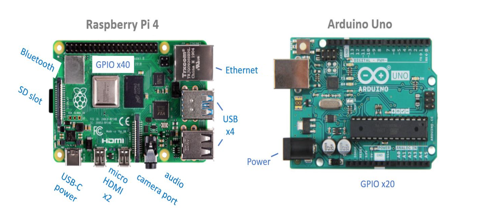
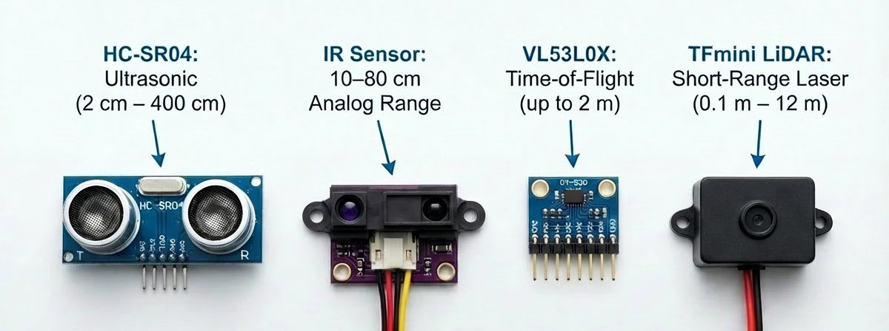
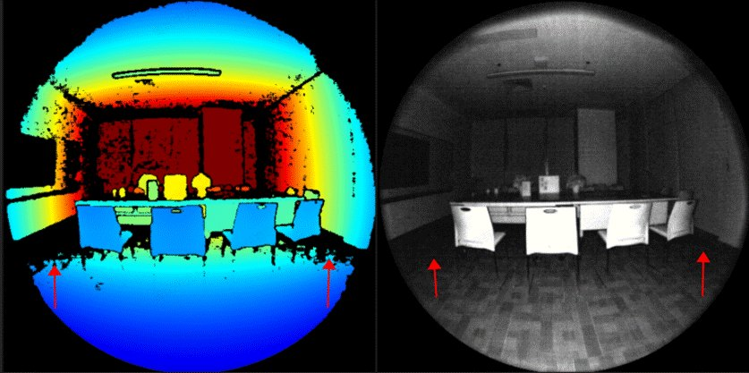

# Class 12

## 📋 Faculty Course Questionnaire (FCQ)

* 15 minutes at the beginning of class for students to complete their online FCQs
* The purpose of the FCQ, how it's used in your course and department, and highlight its importance to you as an instructor.
* Visit [https://colorado.campuslabs.com/eval-home/](https://colorado.campuslabs.com/eval-home/) using a phone, tablet or computer. They will need to authenticate using their campus user ID.

## 🛠️ Hardware

* Custom hardware *inputs* let us:
  * Detect when a person touches an object
  * Know when a basketball goes through a hoop
  * Detect a door opening and closing
* Custom hardware *outputs* let us:
  * Light up a room
  * Create haptic responses
  * Print a custom takeaway
  * And lots more!

See: [Creative Coding Notes list](https://github.com/cacheflowe/creative-coding-notes#physical-computing)

**Some hardware needs special device drivers**

* In this case, there's not a simple messaging scheme (like Serial communication) that you can replicate without major reverse-engineering. for example:
  * Kinect / Realsense

**Some hardware uses electrical signals or common protocols for data transmission**

Raspberry Pi vs Arduino (computer vs microcontroller)

* Raspberry Pi (and similar single-board computers) is a full-fledged computer that runs an operating system and more complex software. You have large storage possibility and can plug in a monitor, mouse, and keyboard. But it also has terminals for connecting sensors other small devices via GPIO pins. This is halfway between a microcontroller and a traditional computer.
* Arduino/esp32 is typically used for direct hardware interfacing with sensors and actuators, running simple programs on a microcontroller. A microcontroller can live on its own as a self-contained device, but can also act as an extension to a computer, with custom inputs & outputs.

## 🛠️ Hardware Protocols

**Common protocols**

**Keyboard/mouse - [HID](https://en.wikipedia.org/wiki/Human_interface_device)**

* [Arduino Leonardo](https://forum.arduino.cc/t/using-arduino-as-a-usb-hid/504918/7)
* [xkeys devices](https://piengineering.com/pages/x-keys)

**Webcams - UVC**

* "[UVC](https://en.wikipedia.org/wiki/USB_video_device_class)" means that a camera of video device can be seen as a webcam by your operating system. Look for this when choosing a camera that you want to use as a standard webcam.

**MIDI**

- [MIDI](http://en.wikipedia.org/wiki/MIDI)

**Network protocols**

* [HTTP](https://developer.mozilla.org/en-US/docs/Web/HTTP/Guides/Messages)
* [WebRTC](https://webrtc.github.io/samples/)
* [WebSocket](http://en.wikipedia.org/wiki/WebSocket)
* [OSC](http://en.wikipedia.org/wiki/Open_Sound_Control)
* [MQTT](https://en.wikipedia.org/wiki/MQTT)
* [gRPC](https://grpc.io/)
* [ZeroMQ](http://zeromq.org)
* [UDP](https://www.cloudflare.com/learning/ddos/glossary/user-datagram-protocol-udp/)

**Serial I/O**

This is how we talk to custom sensors via Arduino (or other microcontrollers). Lots of commercial devices use Serial as well - often, the SDK is built on top of [Serial communication](https://en.wikipedia.org/wiki/Serial_communication), with very specific message formats that send and receive data between the device and the computer. If a device uses Serial, you can probably write your own code to communicate with it directly, even if it's not officially supported. You can talk to Serial devices with Chrome, TouchDesigner, Python, Java, C++, etc.

* Example: [Epic React: Instant Go](https://cacheflowe.com/code/installation/epic-react-instant-go) treadmill
* Example: [30 Years of Air](https://cacheflowe.com/code/installation/30-years-of-air) - sensor & motors

**Wireless protocols**

* [Bluetooth](https://developer.mozilla.org/en-US/docs/Web/API/Web_Bluetooth_API) (can be hard to work with)
* [RFID](https://www.instructables.com/Arduino-Wiring-and-Programming-of-RFID-Sensor/)
  * [NFC](https://en.wikipedia.org/wiki/Near-field_communication)
* [IR](https://roboticsbackend.com/arduino-ir-remote-controller-tutorial-setup-and-map-buttons/)
* [ESP-NOW](https://docs.espressif.com/projects/esp-idf/en/latest/esp32/api-reference/network/esp_now.html)
* [Zigbee](https://docs.arduino.cc/retired/getting-started-guides/ArduinoWirelessShieldS2/)

**Lighting protocols**

* [ArtNet](https://en.wikipedia.org/wiki/Art-Net) ([Addressable LEDs](https://cacheflowe.com/code/lab/artnet-+-processing))
* [DMX](https://en.wikipedia.org/wiki/DMX512) ([Example: Zoom simulation](https://cacheflowe.com/code/installation/zoom-centrifuge))
* [sACN](https://www.lightjams.com/sacn.html)
* [WLED](https://kno.wled.ge/)

**Shared textures between apps**

* [Spout](http://spout.zeal.co/)
* [Syphon](http://www.syphon.v002.info/)

**Video streaming**

* [RTP](https://en.wikipedia.org/wiki/Real-time_Transport_Protocol)
* [NDI](https://www.ndi.tv/)
* [WebRTC](https://webrtc.org/)

**RFID**

- UHF - Ultra High Frequency RFID, typically used for longer-range identification and tracking of objects. Range depends on the strength of the reader and the tag
- LF - Low Frequency RFID, typically used for card readers - close proximity detection. Range is usually a few centimeters.
- NFC - Near Field Communication, typically used for short-range communication between devices, such as contactless payments, contact-sharing, or an alternative to QR codes

## 🛠️ Hardware Devices

**Sensors**

- Proximity sensors - Detect the presence of nearby objects without physical contact, often used for interactive installations or automation.
  - Infrared (IR) & Photoelectric
  - Ultrasonic
  - Microwave
- Capacitive touch
- Motion sensors - Detect movement within a space, often used for security or interactive installations.
- Pressure sensors - Measure the force applied to a surface, often used for interactive installations or monitoring physical interactions.
- Light sensors - Detect ambient light levels, often used for automatic lighting control or interactive installations.
- Temp/humidity/moisture sensors - good for automated environmental monitoring and control, often used in smart homes, agriculture, or climate-sensitive installations.

**Depth Cameras**

* Realsense/Kinect/Femto - Depth cameras that provide high-framerate [3D information](https://new-orbbec3d-s3.s3.amazonaws.com/wp-content/uploads/2023/12/05105219/image016-1.gif), often used for motion tracking in a larger volume.
* LIDAR - Light Detection and Ranging sensors that measure distance by illuminating the target with laser light and measuring the reflection time, often used for mapping and navigation. Usually built for a 360-degree [plane FOV](https://www.robotshop.com/cdn/shop/files/hokuyo_ust_30lc_30m_outdoor_lidar_w_ethernet_outpu_2_1200x1200.webp?v=1761050128) on a rotating platform, though some LIDARs have a wider FOV for 3d scanning.

**...Show & tell if there's time**

## 📝 Homework

**Build something with hardware and/or work on your final project**

* Hardware ideas
  * p5js: use the [Web Serial API](https://web.dev/serial/) with [Justin's example sketch](https://editor.p5js.org/cacheflowe/sketches/F7GG8vuEy) (Chrome only)
  * TouchDesigner: use the Serial node
  * MIDI (Chrome only)
    * [Justin's example sketch](https://editor.p5js.org/cacheflowe/sketches/xuGYeJnZY)
    * [Justin's example sketch 2](https://editor.p5js.org/cacheflowe/sketches/iFMtaetat)
  * Use a camera for computer vision or motion tracking

## 📋 Review code

* Present your ML project or final project progress
